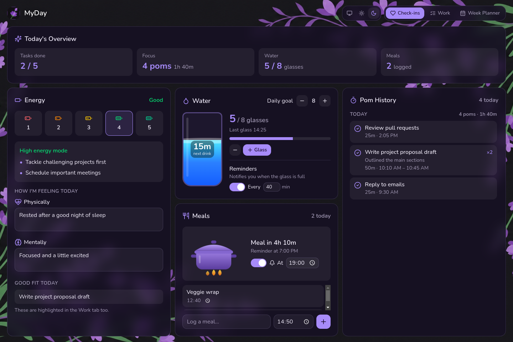
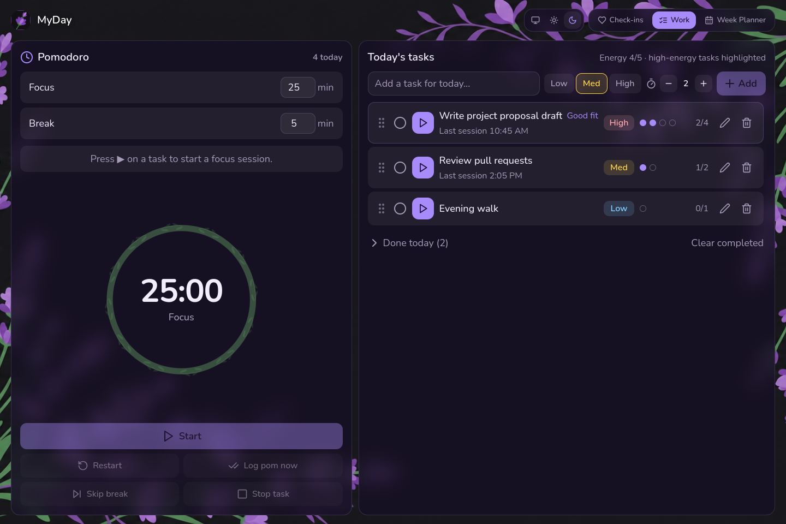
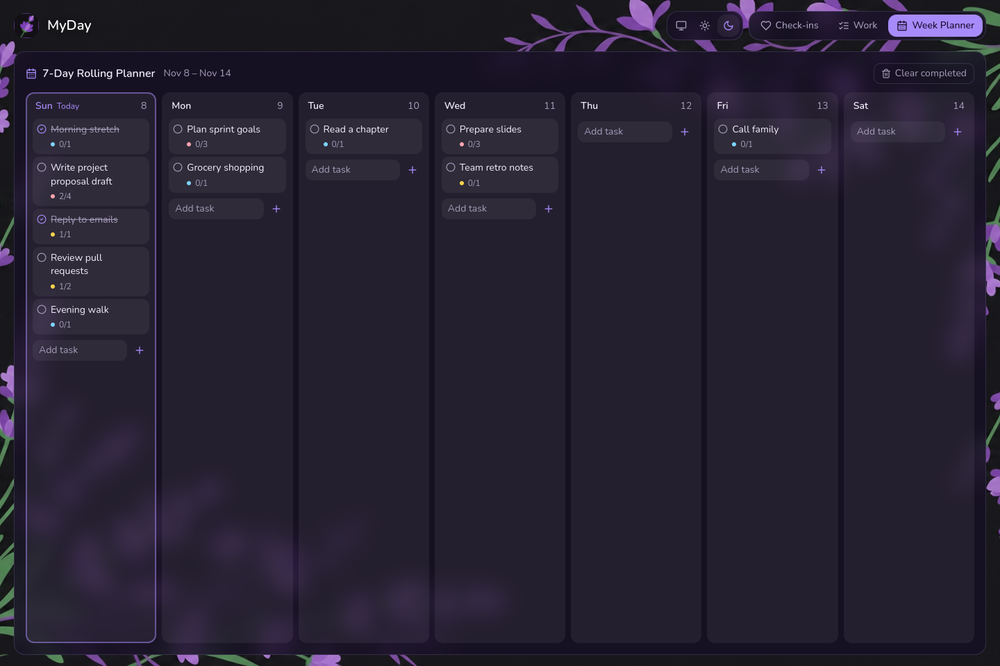

# MyDay

A cozy desktop day planner for Linux and Windows. Check in with your energy, water, food and feelings, focus with a Pomodoro timer tied to your to-do list, and plan the week ahead.



## Features

Light and dark themes are included (or match your system), and everything works offline. Your data stays on your computer.

### Check-ins

A daily overview of tasks done, focus time, water and meals.
- **Energy**: rate your energy from 1 to 5. MyDay suggests how to approach the day and which of today's tasks are a good fit.
- **Feelings**: jot down how you feel physically and mentally.
- **Water**: a daily goal, plus reminders to drink.
- **Meals**: log what you ate, with an optional meal-time reminder.
- **Pom history**: today's focus sessions.

See the screenshot at the top of this page.

### Work

A Pomodoro timer next to today's to-do list. Press ▶ on a task to start a focus session on it.
- Each task has an energy level and an estimate of how many pomodoros it will take.
- Tasks that match your energy today are highlighted.
- Unfinished tasks roll over to the next day.
- You get a desktop notification when a session or break ends.



### Week Planner

A rolling 7-day board starting today. Add tasks to any day and see each one's pomodoro progress.



## Install

Download the latest build from the [Releases page](https://github.com/LibertyQuinzel/LQsDayApp/releases).

### Linux

1. Download `myday-<version>-linux-x86_64.AppImage`.
2. Make it executable, then run it:
   ```bash
   chmod +x myday-*.AppImage
   ./myday-*.AppImage
   ```
   You can also right-click the file → Properties → *Allow executing file as program*, then double-click it.

If it doesn't start on Ubuntu 22.04 or newer, install FUSE 2: `sudo apt install libfuse2`.

### Windows

1. Download `myday-<version>-win-x64.exe` and run it.
2. The installer isn't code-signed yet, so Windows SmartScreen may show *"Windows protected your PC"*. Click **More info → Run anyway**.

### Where your data is saved

Your data is saved in one JSON file, `app-state.json`:

| OS      | Location                                  |
|---------|-------------------------------------------|
| Linux   | `~/.config/MyDay/`                        |
| Windows | `%APPDATA%\MyDay\`                        |

Updating or reinstalling the app doesn't touch this file. Back it up if you want to keep your history.

## Development

You need [Node.js](https://nodejs.org/) 20 or newer.

```bash
npm install
npm run desktop      # build the UI and open the desktop app
npm run dev          # UI only, in the browser with hot reload (saves to localStorage)
npm run typecheck    # TypeScript + Electron main-process checks
npm run screenshots  # regenerate docs/screenshots/*.png using sample data
```

On Linux, `npm run update-app` (or `bash update-app.sh --run`) runs the checks, rebuilds, and can launch the app.

### Project layout

```
src/
  app/          React UI (App.tsx, components/, state.ts)
  electron/     Electron main process, preload bridge, app icon
  styles/       Tailwind + theme CSS
  index.html    Vite entry
scripts/        Cross-platform helper scripts (dev launcher, screenshot capture)
docs/           README screenshots
.github/        CI workflow that builds the release installers
```

The UI is built with React, TypeScript, Vite and Tailwind CSS, and runs inside Electron. The renderer talks to the main process only through the small `window.myDay` bridge in `src/electron/preload.cjs`, which handles reading and writing state and showing notifications.

## Building installers

```bash
npm run dist:linux   # → release/*.AppImage
npm run dist:win     # → release/*.exe  (run on Windows, or on Linux with Wine installed)
```

### Publishing a release

Bump `version` in `package.json`, commit, then push a matching tag:

```bash
git tag v0.1.0
git push origin main --tags
```

GitHub Actions ([`.github/workflows/build.yml`](.github/workflows/build.yml)) then builds the Linux and Windows installers on their own runners and attaches them to a GitHub Release. You can also start the workflow by hand from the **Actions** tab. Builds started that way can be downloaded from the run's artifacts.
